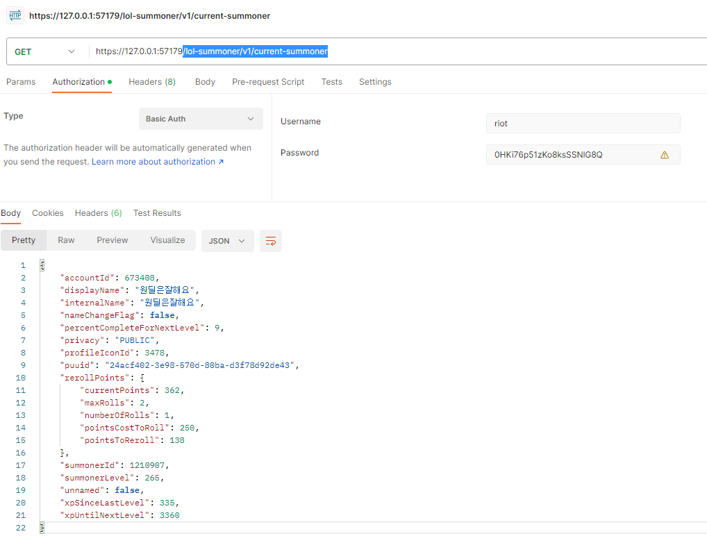

# 목표

- 가능성을 확인하기 위한 프로토타입 프로젝트 작성

# 기초 배경

- Riot은 **게임 내에 직접적인 영향**을 끼치지 않는 Lol Client 연동용 Third Party App 을 일부 허용

## op.gg

- 대표적인 서드파티 앱 운영사
- Riot API 외 LCU API 를 사용한 데스크톱 앱을 제공 중
    - [https://op.gg/desktop/](https://op.gg/desktop/)
- 해당 홈페이지에서도 라이엇 공식 입장 공지사항을 링크로 공유 중
    - [https://support-leagueoflegends.riotgames.com/hc/en-us/articles/225266848](https://support-leagueoflegends.riotgames.com/hc/en-us/articles/225266848)
- 공식 입장은 게임 내 직접적인 영향을 끼치지 않는 한 제제 대상은 아닌것으로 보임

## RIOT API

[Riot Developer Portal](https://developer.riotgames.com/apis)

- 계정 인증 후 토큰만 발급받으면 누구나 RIOT API 에 접근해서 정보를 추출 할 수 있음
- 외부망을 통해 RIOT API 서버와 통신

## LCU API

[Riot Developer Portal](https://developer.riotgames.com/docs/lol#league-client-api)

- LOL 설치시 실행되는 대기 화면 및 각종 정보가 노출되는 CLIENT 용 API
- 로그인, 게임 검색, 참가, 룬 설정, 챔피언 등등 LOL CLIENT 에서 실행되는 모든 행동들이 LCU API를 통해서 조작됨
- 다만 RIOT 에서 공식적으로 제공하는 API는 아니라 RIOT API 에는 상세 문서가 없음

# 참고 프로그램

## 닷지 알람

[https://github.com/gomiseki/Dodge-Alarm](https://github.com/gomiseki/Dodge-Alarm)

## autobot

[AutoBot2 | 롤 유틸리티 프로그램 (Version_2.4.1) - 개발 중지](https://jaeho0613.tistory.com/162)

# LCU API 접근 방법

## 레퍼런스

[Getting started with the LCU API](https://hextechdocs.dev/getting-started-with-the-lcu-api/)

[https://riotclient.kebs.dev/#operation--GET /accounts-security/v1/access](https://riotclient.kebs.dev/#operation--GET%20/accounts-security/v1/access)

## 필요 조건

1. 롤 CLIENT 가 켜져 있어야 한다.
2. 로그인 완료된 상태여야 한다.

## 준비 사항

1. 롤 CLIENT 설치 경로가 파악되어야 한다.
2. 롤 CLIENT 설치 경로 내 **lockfile** 을 편집기로 오픈할 수 있어야 한다.
3. lockfile 내에서 lol client 의 로컬 호스트 PORT 와 임시 비밀번호를 출력해야한다.

## 인증

- Basic Auth
    - ID: riot
    - PW: lockfile 내 String으로 생성

## GET /lol-summoner/v1/current-summoner

- 서모너 기본정보 출력

# repository

- [https://github.com/ppzxc/league-harvester](https://github.com/ppzxc/league-harvester)
- [https://github.com/ppzxc/league-harvester-server](https://github.com/ppzxc/league-harvester-server)